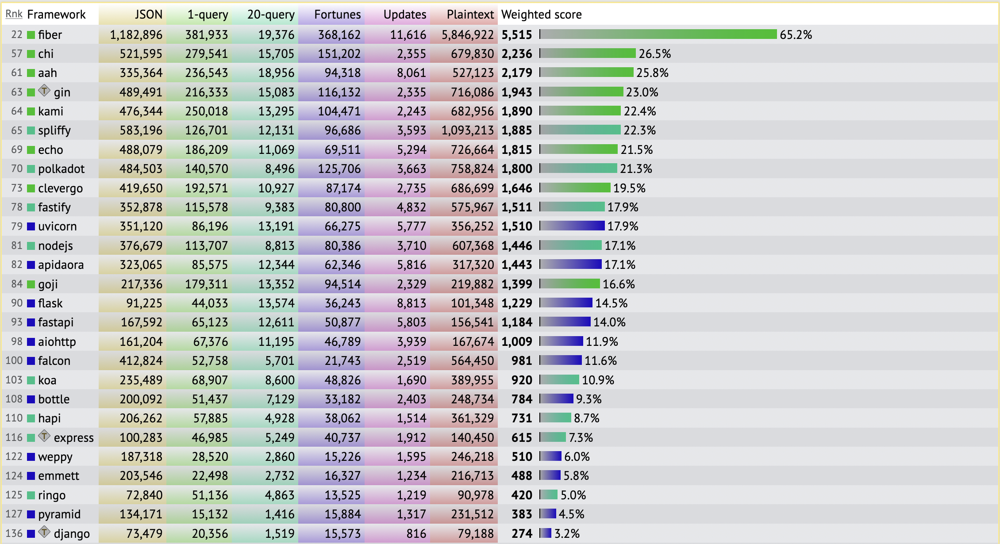

# Choosing Go, Chi, and Huma for the AREA Backend

We are a team of four. Our backend must provide a shared API for the web and Android clients, detect events even when the clients are closed, and run the associated workflows. The brief requires at least five services and ten Actions and REActions combined. At least half of the services must require OAuth2 authorization. See the AREA brief, sections “Hooks”, “Clients & Server”, and “Deliverables and expectations”.

## Prototype Comparison

We compared Go, Rust, and TypeScript in three spikes limited to 25 minutes each. We used the same target for all three. The server had to read its port from `PORT`, be able to listen on `8080`, and return exactly `{"status":"ok"}` for `GET /ping`.

| Technology | Prototype HTTP dependencies | Time to first success | Most time-consuming step |
| --- | --- | --- | --- |
| Go | `net/http` from the standard library | 12 min | Looking up how to proceed in the Go documentation. |
| Rust | Axum and Tokio | 20 min | Figuring out how to set up the server. |
| TypeScript | Express on Node.js | 5 min | Refreshing our knowledge of the language. |

All three prototypes reached the target. The times cover setting up the route and configuring the port during each spike. Everyone on the team already knew TypeScript, which made it more predictable to get started with. [Spike comparison](../spikes/DISTANCE.md) · [Go code](../spikes/Go/server.go) · [Rust code](../spikes/Rust/src/main.rs) · [TypeScript code](../spikes/Typescript/main.ts)

### Reproduce the Go Prototype

From the repository root, start the server with port `8080` available.

```sh
cd docs/spikes/Go
PORT=8080 go run .
```

In a second terminal, `curl -fsS http://localhost:8080/ping` should return `{"status":"ok"}`.

## Why Go Fits AREA

- **A shared API for both clients.** We can use Chi to group related routes and use Huma v2 to document typed operations, including the route that exposes the catalogue of Services, Actions, and REActions. We can use `httptest` to check the actual responses against the OpenAPI contract, including errors. [Chi](https://github.com/go-chi/chi) · [Huma OpenAPI generation](https://huma.rocks/features/openapi-generation/) · [httptest](https://pkg.go.dev/net/http/httptest)
- **Autonomous hooks.** We can use goroutines to detect events alongside the HTTP server and `context` to shut down those tasks cleanly. The engine controls the order of reactions within each workflow. We also need to decide how to identify and track events we have already processed, as the brief requires. [Goroutines](https://go.dev/doc/effective_go#goroutines) · [context](https://pkg.go.dev/context)
- **Calls to third-party services.** The `net/http` client lets us set timeouts for outbound requests. If a service called by a reaction takes too long to respond, we can report the failure to the engine. We can share this component across integrations while keeping each service’s settings and permissions separate. [Go HTTP client](https://pkg.go.dev/net/http#Client)
- **An explicit workflow model.** Go structs let us represent triggers, reactions, and conditions with typed data. We can validate the rules from the brief when saving a workflow. For example, we can check that it has at most one condition and that every reference points to data declared by an earlier node.
- **A backend we can integrate with Docker Compose.** `go build` produces a server executable. We can compile it in a container build stage and run it from the final image. This gives us a starting point for the reproducible build required by the brief. [go build command](https://pkg.go.dev/cmd/go#hdr-Compile_packages_and_dependencies)

## Go HTTP Framework Benchmark

### Published TechEmpower Results



*Historical TechEmpower results. Fiber has the highest weighted score among the Go entries shown, which include Chi, Gin, and Echo. The results reflect the benchmark configurations used by TechEmpower.* [TechEmpower benchmark suite](https://github.com/TechEmpower/FrameworkBenchmarks)

### Local JSON Endpoint Benchmark

We implemented `GET /ping` with five options and verified that each returns HTTP `200`, an `application/json` content type, and `{"status":"ok"}` aside from optional trailing whitespace. We disabled Huma’s optional schema link in the benchmark to keep the response body comparable. We used the same Go HTTP client configuration for all five options and sent sequential requests over a reused HTTP/1.1 loopback connection to each server’s native listener. We ran the benchmark on Linux with an AMD Ryzen 9 5900HX and Go 1.27.4. The table reports the median of five runs per option with `-cpu=1`. [Benchmark code](../spikes/Go/framework-benchmark/benchmark_test.go)

| HTTP stack | Time per request (ns/op) | Allocated bytes (B/op) | Allocations per request |
| --- | ---: | ---: | ---: |
| `net/http` | 45,790 | 6,874 | 79 |
| Chi v5.5.0 | 48,083 | 7,242 | 81 |
| **Chi v5.5.0 + Huma v2.41.0** | **48,600** | **7,442** | **86** |
| Gin v1.12.0 | 47,480 | 6,906 | 80 |
| Fiber v3.7.0 | 38,228 | 4,659 | 60 |

Fiber had the lowest median time and fewest allocations in this test. Chi and Chi with Huma had overlapping timings across the five runs. These figures include the client, loopback transport, routing, and JSON response. The effect on AREA workflows remains to be measured with OAuth2, third-party calls, and database access in place.

The command below runs the response checks, the OpenAPI discovery test, and the benchmark. It uses ephemeral local TCP ports.

```sh
cd docs/spikes/Go/framework-benchmark
GOTOOLCHAIN=go1.27.4 go test -mod=readonly -v -bench '^BenchmarkPing$' -benchmem -benchtime=300ms -count=5 -cpu=1
```

### Framework Choice for AREA

We chose **Chi with Huma v2** for the AREA HTTP API. Chi gives us route groups and direct access to standard `net/http` middleware for account, workflow, and service routes. We mount Huma on Chi through `humachi`. Huma builds the OpenAPI description from typed operations and validates incoming data. This gives the web and Android clients a browsable contract based on the types used by the backend. [Chi](https://github.com/go-chi/chi) · [Huma router adapters](https://huma.rocks/features/bring-your-own-router/) · [Huma request validation](https://huma.rocks/features/request-validation/)

The prototype checks that `/docs` returns HTML and that `/openapi.json` describes the `200` JSON response from `GET /ping`. For the MVP, we still need to test `POST /workflows` with valid input, invalid input, and an unauthenticated request, checking the documented statuses and bodies against the actual responses.

## Security and Dependencies

The original Go spike used only the standard library. We selected Chi for routing and Huma v2 for the API contract and input validation. OAuth2 security depends on the library we choose, how it is maintained, and how we use it. We plan to integrate OAuth2 for the third-party services required by the brief. The OAuth2 library choice remains open.

For AREA, we need to verify OAuth2 callback validation, limit the permissions we request, and protect the tokens the server stores for hooks. A first experiment could connect a real service and check that the backend rejects an invalid OAuth2 callback. The current spike covers server startup and the behavior of `/ping`. [OAuth 2.0 security recommendations](https://www.rfc-editor.org/rfc/rfc9700.html)

## Decision

We chose **Go** because we wanted to learn a new technology as a team. We had all used TypeScript before, so it would have let us move faster at the start. Rust offered an opportunity to explore its optimization options, and we spent more time figuring out how to set up its server.

For us, Go is the middle ground. It gives us a new technology to learn, and we got the first route working in 12 minutes with the standard library. We accept that getting up to speed will take longer than with TypeScript.
